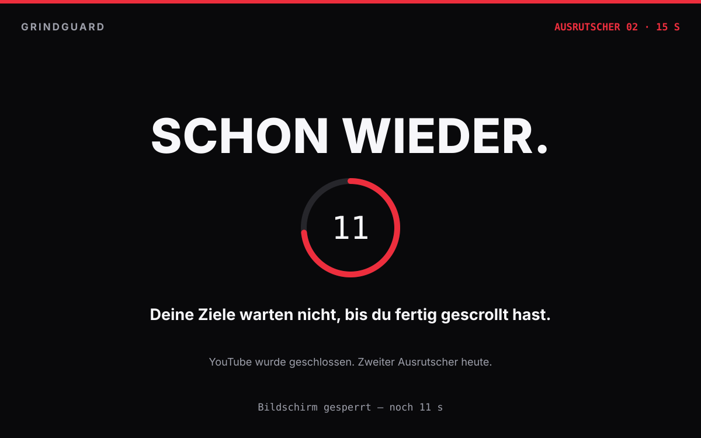

<p align="center">
  
</p>

# GrindGuard

[](https://github.com/levinalessio/grindguard/actions/workflows/ci.yml)
[](LICENSE)
· macOS 13–27 · Windows 10/11 · [English](README.md)

**Du öffnest YouTube. GrindGuard macht es zu und sperrt den Bildschirm.**

GrindGuard schaut, was gerade vor dir offen ist. Sobald eine gesperrte Website, Suche oder App auftaucht, schliesst er sie und sperrt den Bildschirm für ein paar Sekunden. Dazu kommt eine Warnung, die nichts schönredet. Danach bringt er dich zurück in die App, in der du gearbeitet hast.

- Der erste Ausrutscher des Tages kostet 10 Sekunden, jeder weitere 5 mehr, höchstens 60.
- Drei Ausrutscher in zehn Minuten heissen: Du suchst einen Umweg. Dann gibt es sofort das Maximum.
- Eine Fokus-Sitzung friert deine Listen ein und sperrt `pause`, `stop` und `uninstall`, bis die Zeit um ist.

GrindGuard braucht kein Konto und keine Cloud, schickt nichts nach Hause und installiert nichts nach. Es sind rund 4800 Zeilen Shell, JavaScript und PowerShell, die Einstellungen liegen in Textdateien. Das liest du an einem Abend durch.

## Was GrindGuard nicht ist

GrindGuard ist eine Bremsschwelle gegen den Reflex, kein Tresor. Ausserhalb einer Fokus-Sitzung kannst du ihn jederzeit anhalten. Wer Admin-Rechte hat, kann ihn beenden. Und wer wirklich will, kommt um jeden Blocker herum, der auf dem eigenen Gerät läuft. Jeden bekannten Umweg und was ihn (falls überhaupt) erkennt, findest du in [docs/BYPASS-MATRIX.md](docs/BYPASS-MATRIX.md). Suchst du etwas, das du selbst nicht mehr rückgängig machen kannst: Cold Turkey, SelfControl, oder du gibst den Bildschirmzeit-Code jemand anderem.

## Installieren

### macOS

1. `GrindGuard-macOS.zip` unter [Releases](../../releases) herunterladen und entpacken (Safari macht das meist automatisch).
2. Terminal öffnen und eingeben:
   ```sh
   bash ~/Downloads/GrindGuard/install.sh
   ```
3. Es erscheint 6 Sekunden lang eine Test-Warnung. Ab jetzt startet GrindGuard mit jeder Anmeldung.
4. In den Browser wechseln. macOS fragt, ob `bash` oder `osascript` Safari bzw. Chrome steuern darf: **Erlauben**. Ohne dieses OK sieht GrindGuard keine Websites. Nachträglich änderst du das unter Systemeinstellungen → Datenschutz & Sicherheit → Automation.
5. Kontrolle: `~/GrindGuard/grind doctor`

**Browser auf dem Mac:** Safari, Chrome, Chromium, Brave, Edge, Arc, Dia, Vivaldi, Opera, Orion, Comet, ChatGPT Atlas und Helium. Firefox-Browser (Firefox, Zen, LibreWolf) lassen sich die Adresse nicht von anderen Programmen auslesen. `grind doctor` warnt dich, wenn einer installiert ist.

**Läuft seit einem macOS-Update nicht mehr?** macOS 27 startet keinen LaunchAgent, dessen plist-Datei die Download-Markierung (Quarantäne) trägt. Version 1.3 entfernt diese Markierung und zeigt die echte Fehlermeldung von launchd, statt still zu scheitern. Prüfen mit `~/GrindGuard/grind doctor`. Noch auf 1.2:
```sh
xattr -d com.apple.quarantine ~/Library/LaunchAgents/com.grindguard.agent.plist
~/GrindGuard/grind start
```

### Windows

1. `GrindGuard-Windows.zip` unter [Releases](../../releases) herunterladen, Rechtsklick → **Alle extrahieren**.
2. Doppelklick auf `INSTALLIEREN.cmd`. Windows warnt, weil die Datei aus dem Internet kommt und (noch) nicht signiert ist: **Weitere Informationen → Trotzdem ausführen**.
3. Es erscheint 6 Sekunden lang eine Test-Warnung. Das **G.**-Symbol in der Taskleiste zeigt, dass der Wächter läuft (schwarz = aktiv, rot = Fokus-Sitzung, grau = Pause). Ein Klick darauf: Fokus-Sitzung, Pause, Einstellungen.
4. Kontrolle in PowerShell: `~\GrindGuard\grind doctor`

**Einstellungen** (Startmenü → GrindGuard, oder Klick aufs Symbol): jede Website, jede Suche und jedes Programm einzeln an und aus, eigene Einträge, laufende Programme mit einem Klick sperren, Ton und Design der Sperre, Sperrzeiten, aktive Zeiten, Statistik. Jede Änderung wirkt sofort.

**Aktualisieren:** Einstellungen → Über → *Nach Updates suchen*. GrindGuard holt die neue Version von GitHub, prüft die Prüfsumme und startet den Installer. Von selbst prüft er nie.

**Entfernen:** wie jedes Programm unter Windows-Einstellungen → Apps, mit `DEINSTALLIEREN.cmd` im GrindGuard-Ordner oder im Menü unter *Mehr*. Während einer Fokus-Sitzung nicht.

**Browser unter Windows:** Chrome, Edge, Brave, Opera, Vivaldi, Chromium, Thorium, Arc, Comet, Firefox, LibreWolf, Waterfox, Floorp und Zen. Die Adresse liest GrindGuard über die Bedienungshilfen von Windows (UI Automation). Klappt das nicht, etwa im Vollbild, erkennt er die Seite am Fenstertitel.

Schul- oder Firmen-Laptop? Dort sperrt die IT oft Skripte. `grind doctor` sagt es dir, und installier GrindGuard nur, wo du darfst.

### iPhone

Auf dem iPhone lässt Apple kein Programm andere Apps überwachen. Die Anleitung in `LIESMICH.txt` (Mac-Paket) zeigt, wie du dasselbe Verhalten mit der App „Kurzbefehle“ baust: eine Automation, die beim Öffnen einer gesperrten App auslöst. Websites sperrst du dort mit der Bildschirmzeit.

## Im Alltag

| Befehl | Was passiert |
|---|---|
| `grind status` | Läuft er? Wie viele Ausrutscher heute? |
| `grind fokus 50` | Fokus-Sitzung, hier 50 Minuten (5–240). Verlängern geht, verkürzen nicht. |
| `grind notausstieg` | Notausstieg: Du tippst einen Satz ab, nach 10 Minuten endet die Sitzung. |
| `grind pause 20` | Bewusste Pause, hier 20 Minuten (max. 120). Nicht während einer Fokus-Sitzung. |
| `grind weiter` | Pause sofort beenden |
| `grind check <adresse>` | Gesperrt? Und welche Zeile deiner Liste ist schuld? |
| `grind stats` | Ausrutscher der letzten 7 Tage |
| `grind edit` | Listen, Sprüche und Einstellungen öffnen |
| `grind test [design]` | Warnung zur Probe (Windows: `nacht`, `kobalt`, `papier`, `lexikon`, `bordeaux`) |
| `grind einstellungen` | Windows: Einstellungen öffnen |
| `grind update` | Windows: neueste Version von GitHub holen und installieren |
| `grind doctor` | Rechte, Autostart, Browser und Alarmton prüfen |
| `grind stop` / `grind uninstall` | Anhalten bis zur nächsten Anmeldung / entfernen. Nicht während einer Fokus-Sitzung. |

Auf dem Mac heisst der Befehl `~/GrindGuard/grind`, unter Windows `~\GrindGuard\grind` (PowerShell) bzw. `%USERPROFILE%\GrindGuard\grind` (cmd).

## Regeln

Alles steht in vier Textdateien in `~/GrindGuard/config`. Änderungen wirken nach etwa 15 Sekunden, ohne Neustart.

```text
youtube.com                 die ganze Seite samt Subdomains
youtube.com/shorts          nur dieser Bereich
+music.youtube.com          Ausnahme: bleibt erlaubt
google.com/search*udm=7*    mit Stern: der Video-Tab der Google-Suche
suche: mp3                  jede Suche mit diesem Wort, in jeder Suchmaschine
```

Die üblichen Umwege erkennt GrindGuard selbst: Google Übersetzer als Proxy (`youtube-com.translate.goog`), doppelte Schrägstriche (`//shorts`), verschlüsselte Buchstaben (`%73horts`) und die Suchfelder von Google, Bing, DuckDuckGo, Yahoo, Startpage, Yandex, Baidu, Ecosia, Brave und der YouTube-Suche. Alles Weitere: [docs/RULES.md](docs/RULES.md).

In `apps.txt` stehen Programme, die zugehen, sobald sie im Vordergrund sind (Mac: Name oder Bundle-ID, Windows: Prozessname). In `sprueche.txt` stehen die Sprüche der Warnung, und am härtesten trifft, was du selbst schreibst. `einstellungen.txt`:

| Einstellung | Standard | Bedeutung |
|---|---|---|
| `TON` | `brutal` | `brutal`, `direkt` (sachlich) oder `ruhig` (freundlich, ohne Sprüche) |
| `SPERRZEIT_START` / `_PLUS` / `_MAX` | 10 / 5 / 60 | Sperrzeit in Sekunden |
| `JAGD` | 1 | Drei Ausrutscher in 10 Minuten = sofort maximale Sperre |
| `ZURUECK` | 1 | Nach der Sperre zurück zur letzten erlaubten App |
| `HART_BEENDEN` | 1 | Programme hart beenden, wenn sie normales Beenden ignorieren |
| `AKTIVE_ZEIT` / `AKTIVE_TAGE` | immer | z. B. `08:00-18:00` und `12345` für werktags |
| `STIMME`, `ALARMTON`, `LAUTSTAERKE` | an, an, 100 | Stimme, Alarmton, Lautstärke |

## So funktioniert es

Etwa einmal pro Sekunde fragt GrindGuard das System, welche App vorne ist. Ist es ein Browser, liest er die Adresse des aktiven Tabs: auf dem Mac per AppleScript, unter Windows über UI Automation. Eine Regel-Engine, zweimal umgesetzt, entscheidet. Ausnahmen schlagen Suchbegriffe, und Suchbegriffe schlagen gesperrte Seiten. Der Sperrbildschirm ist ein randloses Fenster über allem, auf jedem Bildschirm. Auf dem Mac ist das AppKit über JavaScript for Automation, unter Windows WinForms.

Beide Umsetzungen laufen gegen denselben Katalog von 106 kniffligen Adressen ([tests/corpus](tests/corpus)). Eine Regel bedeutet also auf beiden Systemen dasselbe. Details: [docs/ARCHITECTURE.md](docs/ARCHITECTURE.md).

## Datenschutz

Alles bleibt auf deinem Gerät, GrindGuard baut keine Netzwerkverbindung auf. Gespeichert wird in `~/GrindGuard/state`, wann welche Seite oder App gesperrt wurde (bei Suchen nur der passende Begriff aus deiner Liste), dazu ein Fehlerprotokoll. Löschen: den Ordner leeren. Mehr: [docs/PRIVACY.md](docs/PRIVACY.md).

## Entwickeln

```sh
tools/build.sh --no-zip          # dist/macos und dist/windows aus den Quellen bauen
bash tests/macos/run_tests.sh    # Engine, Sperrbildschirm, Wächter mit simulierten macOS-Befehlen
SH=dash bash tests/macos/run_tests.sh
bash tests/macos/run_install_test.sh
node tests/macos/overlay_mock.js dist/macos/GrindGuard/app/lib/overlay.js
tests/corpus/run.sh              # Mac und Windows müssen bei allen Katalog-Adressen gleich entscheiden
python3 tools/check_encoding.py  # CRLF + BOM für Windows, LF für alles andere
```

Das CI läuft auf Linux und echtem macOS. Unter Windows parst es die Skripte mit Windows PowerShell 5.1, lässt PSScriptAnalyzer laufen und prüft den Katalog mit der echten PowerShell-Engine. Siehe [CONTRIBUTING.md](CONTRIBUTING.md).

## Wie es weitergeht

1.3 ist das letzte grosse Release der Skript-Version. Der Vorschlag für 2.0: ein kleiner gemeinsamer Kern in Rust, Browser-Erweiterungen statt Adressleisten-Auslesen, Ereignisse statt Abfragen im Sekundentakt und eine echte Menüleisten- bzw. Tray-App. Plan und offene Fragen: [docs/ROADMAP.md](docs/ROADMAP.md).

## Lizenz

[MIT](LICENSE). Einen Fehler oder einen Umweg gefunden? [Issue aufmachen](../../issues/new/choose). Ein Sicherheitsproblem? Siehe [SECURITY.md](SECURITY.md).
