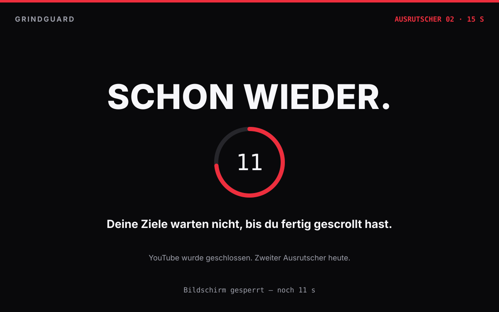

<p align="center">
  
</p>

# GrindGuard

[](https://github.com/levinalessio/grindguard/actions/workflows/ci.yml)
[](LICENSE)
· macOS 13–27 · Windows 10/11 · [Deutsch](README.de.md)

**You open YouTube. GrindGuard closes it and locks your screen.**

It watches what is in front of you. The moment a blocked site, search or app shows up, GrindGuard closes it, locks the screen for a few seconds with a warning that does not sugarcoat anything, and then drops you back into the app you were working in.

- The first slip of the day costs 10 seconds. Every further slip adds 5, up to 60.
- Three slips in ten minutes means you are hunting for a detour, so you get the maximum straight away.
- Focus sessions freeze your lists and disable `pause`, `stop` and `uninstall` until the time is up.

No account, no cloud, no telemetry, nothing to install besides the tool itself. About 4,800 lines of shell, JavaScript and PowerShell with plain-text config you can read in an evening.

> **The app speaks German.** Commands, warnings and config comments are German for now. An English UI is on the [roadmap](docs/ROADMAP.md). This README is in English so you can decide whether that is a deal-breaker before you install.

## What it is not

GrindGuard is a speed bump for the reflex, not a vault. Outside a focus session you can stop it at any time. Anyone with admin rights can kill it, and a determined person will find a way around any blocker that runs on their own machine. [docs/BYPASS-MATRIX.md](docs/BYPASS-MATRIX.md) lists every known way around it and what (if anything) catches it. If you need something you cannot undo yourself, look at Cold Turkey or SelfControl, or hand your Screen Time code to someone else.

## Install

### macOS

1. Download `GrindGuard-macOS.zip` from [Releases](../../releases) and unzip it. Safari usually does this for you.
2. Open Terminal and run:
   ```sh
   bash ~/Downloads/GrindGuard/install.sh
   ```
3. A 6-second test warning appears. From now on GrindGuard starts with every login.
4. Switch to your browser. macOS asks whether `bash` or `osascript` may control Safari or Chrome. Click **Allow**, otherwise GrindGuard cannot see websites. You can change this later in System Settings → Privacy & Security → Automation.
5. Check that everything is in place: `~/GrindGuard/grind doctor`

**Browsers on macOS:** Safari, Chrome, Chromium, Brave, Edge, Arc, Dia, Vivaldi, Opera, Orion, Comet, ChatGPT Atlas and Helium. Firefox-based browsers (Firefox, Zen, LibreWolf) do not let other programs read the address bar, so `grind doctor` warns you if one is installed.

**Stopped working after a macOS update?** On macOS 27, launchd refuses a LaunchAgent whose plist carries the download quarantine flag. Version 1.3 strips that flag and shows launchd's real error message instead of failing silently. Run `~/GrindGuard/grind doctor`. If you are still on 1.2:
```sh
xattr -d com.apple.quarantine ~/Library/LaunchAgents/com.grindguard.agent.plist
~/GrindGuard/grind start
```

### Windows

1. Download `GrindGuard-Windows.zip` from [Releases](../../releases), right-click → **Extract All**.
2. Double-click `INSTALLIEREN.cmd`. Windows warns you because the file comes from the internet and is not signed (yet). Choose **More info → Run anyway**.
3. A 6-second test warning appears. The **G.** icon in the tray shows the guard is active (black = active, red = focus session, grey = paused). Click it for focus sessions, pause and settings.

**Settings** (Start menu → GrindGuard, or click the icon): switch every site, search term and program on or off individually, add your own entries, block a running program with one click, choose tone and design of the lock screen, lock times, active hours and see your stats. Every change applies immediately.

**Updating:** Settings → Über → *Nach Updates suchen*. GrindGuard downloads the new version from GitHub, verifies the checksum and runs the installer. It never checks on its own.

**Uninstalling:** like any other program under Windows Settings → Apps, with `DEINSTALLIEREN.cmd` in the GrindGuard folder, or in the tray menu under *Mehr*. Not during a focus session.
4. Check: open PowerShell and run `~\GrindGuard\grind doctor`

**Browsers on Windows:** Chrome, Edge, Brave, Opera, Vivaldi, Chromium, Thorium, Arc, Comet, Firefox, LibreWolf, Waterfox, Floorp and Zen. GrindGuard reads the address bar through Windows UI Automation. When that does not work (fullscreen video, for example), it falls back to window-title rules.

School or work laptop? IT often blocks scripts there. `grind doctor` will tell you, and you should only install it where you are allowed to.

### Phone

iOS does not let any program watch other apps. The macOS readme (`LIESMICH.txt`) shows how to build the same behaviour with the built-in Shortcuts app (an automation that fires when a blocked app opens) and how to block sites with Screen Time.

## Daily use

| Command | What it does |
|---|---|
| `grind status` | Is it running? How many slips today? |
| `grind fokus 50` | Focus session for 50 minutes (5–240). Can be extended, not shortened. |
| `grind notausstieg` | Emergency exit from a focus session: type a sentence, then it ends after 10 minutes. |
| `grind pause 20` | Deliberate break, here 20 minutes (max. 120). Not available during a focus session. |
| `grind weiter` | End the break now. |
| `grind check <url>` | Would this be blocked, and which line of your list is responsible? |
| `grind stats` | Slips over the last 7 days. |
| `grind edit` | Open lists, quotes and settings. |
| `grind test [design]` | Show the warning once (Windows: `nacht`, `kobalt`, `papier`, `lexikon`, `bordeaux`). |
| `grind einstellungen` | Windows: open the settings. |
| `grind update` | Windows: fetch and install the latest version from GitHub. |
| `grind doctor` | Check permissions, autostart, browsers and the alarm sound. |
| `grind stop` / `grind uninstall` | Stop until next login / remove. Not available during a focus session. |

On macOS the command is `~/GrindGuard/grind`, on Windows `~\GrindGuard\grind` (PowerShell) or `%USERPROFILE%\GrindGuard\grind` (cmd).

## Rules

Everything lives in four text files in `~/GrindGuard/config`. Changes apply within about 15 seconds, without a restart.

```text
youtube.com                 the whole site, including subdomains
youtube.com/shorts          only this section
+music.youtube.com          exception: stays allowed
google.com/search*udm=7*    wildcard: Google's video tab
suche: mp3                  any search containing this word, on any engine
```

GrindGuard also catches the common detours by itself: Google Translate as a proxy (`youtube-com.translate.goog`), doubled slashes (`//shorts`), percent-encoded letters (`%73horts`), and search parameters of Google, Bing, DuckDuckGo, Yahoo, Startpage, Yandex, Baidu, Ecosia, Brave and YouTube search. Full reference: [docs/RULES.md](docs/RULES.md).

`apps.txt` lists programs that get closed as soon as they come to the front (by name or bundle ID on macOS, by process name on Windows). `sprueche.txt` holds the quotes on the lock screen, and your own lines hit hardest. `einstellungen.txt` holds the settings:

| Setting | Default | Meaning |
|---|---|---|
| `TON` | `brutal` | `brutal`, `direkt` (factual) or `ruhig` (calm, no quotes) |
| `SPERRZEIT_START` / `_PLUS` / `_MAX` | 10 / 5 / 60 | Lock time in seconds |
| `JAGD` | 1 | Three slips in 10 minutes → maximum lock time |
| `ZURUECK` | 1 | Return to the last allowed app after the lock |
| `HART_BEENDEN` | 1 | Force-quit apps that ignore a normal quit |
| `AKTIVE_ZEIT` / `AKTIVE_TAGE` | always | e.g. `08:00-18:00` and `12345` for weekdays |
| `STIMME`, `ALARMTON`, `LAUTSTAERKE` | on, on, 100 | Voice, alarm sound, volume |

## How it works

About once a second GrindGuard asks the OS which app is in front. If it is a browser, it also asks for the URL of the active tab: AppleScript on macOS, UI Automation on Windows. One rule engine, implemented twice, decides on the outcome. Exceptions win over search terms, and search terms win over blocked sites. The lock screen is a borderless window above everything else, on every display. On macOS that is AppKit via JavaScript for Automation; on Windows it is WinForms.

Both implementations are tested against the same corpus of 106 tricky URLs ([tests/corpus](tests/corpus)), so a rule means the same thing on both systems. Details: [docs/ARCHITECTURE.md](docs/ARCHITECTURE.md).

## Privacy

Everything stays on your machine. GrindGuard opens no network connections. It stores which site or app it blocked and when (for searches, only the matching term from your list), plus an error log, in `~/GrindGuard/state`. To delete it, empty that folder. More: [docs/PRIVACY.md](docs/PRIVACY.md).

## Development

```sh
tools/build.sh --no-zip          # build dist/macos and dist/windows from the sources
bash tests/macos/run_tests.sh    # engine, lock screen and daemon with mocked macOS commands
SH=dash bash tests/macos/run_tests.sh
bash tests/macos/run_install_test.sh
node tests/macos/overlay_mock.js dist/macos/GrindGuard/app/lib/overlay.js
tests/corpus/run.sh              # macOS and Windows must agree on all corpus URLs
python3 tools/check_encoding.py  # CRLF + BOM for Windows, LF for everything else
```

CI runs all of this on Linux and real macOS. On Windows it parses the scripts with Windows PowerShell 5.1, runs PSScriptAnalyzer and runs the corpus through the real PowerShell engine. See [CONTRIBUTING.md](CONTRIBUTING.md).

## Roadmap

Version 1.3 is the last big release of the script version. The proposal for 2.0 is a small Rust core shared by both platforms, browser extensions instead of address-bar scraping, event-driven watching instead of polling, and a real menu bar and tray app. Plan and open questions: [docs/ROADMAP.md](docs/ROADMAP.md).

## License

[MIT](LICENSE). Found a bug or a way around it? [Open an issue](../../issues/new/choose). Found a security problem? See [SECURITY.md](SECURITY.md).
